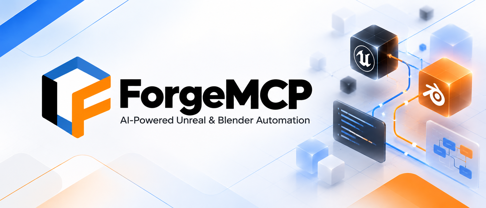

# ForgeMCP



Local MCP integration for **Unreal Engine and Blender**, developed by **Majestic Creations**.
ForgeMCP connects an MCP client to native application adapters for project inspection,
reviewed editing, and asset-transfer workflows.

**Work in progress — alpha testing.** Features and acceptance coverage are evolving.
Use the testing packages with disposable projects/scenes and preserve checkpoints before testing writes.

[Testing release](https://github.com/mcographics/ForgeMCP/releases/tag/testing-2026-10-24) | [Encyclopedia](ForgeMCP_Encyclopedia/00_Master_Index/ForgeMCP_Encyclopedia.md) | [Latest development updates](ForgeMCP_Encyclopedia/00_Master_Index/Latest_Development_Updates.md)

## Download the testing builds

**Release-testing kit: October 24, 2026**

| Component | Build | Testing target | Download |
| --- | --- | --- | --- |
| Complete kit | All components below | Windows x64 | [Complete testing kit](https://github.com/mcographics/ForgeMCP/releases/download/testing-2026-10-24/ForgeMCP-ReleaseTesting-20261024-UE5.6.1-Blender5.2.3-LTS-Win64.zip) |
| Unreal plugin | **0.2.17-alpha.1** (31) | Unreal Engine **5.6.1**, Win64 Editor; BuildId **43139311** | [Plugin ZIP with compiled DLLs](https://github.com/mcographics/ForgeMCP/releases/download/testing-2026-10-24/ForgeMCP-Unreal-Alpha-0.2.17-alpha.1-UE5.6.1-Win64.zip) |
| Blender add-on | **0.2.36-alpha.1** | Blender **5.2.3 LTS** | [Add-on ZIP](https://github.com/mcographics/ForgeMCP/releases/download/testing-2026-10-24/ForgeMCP-Blender-Addon-0.2.36-alpha.1-Blender5.2.3-LTS.zip) |
| External MCP host | **0.3.15** | Python **3.11+** | [Host ZIP](https://github.com/mcographics/ForgeMCP/releases/download/testing-2026-10-24/ForgeMCP-MCP-Host-0.3.15.zip) |

The release is a **WIP prerelease**, not a stable production release. It includes installation
instructions, checksums, and a verification manifest. Extract the complete kit first;
install the individual archives inside it. The source checkout and GitHub-generated
source archives do not include compiled plugin DLLs.

## Install for testing

### Unreal Engine 5.6.1

1. Save your work and close the target Unreal Editor.
2. Extract the Unreal plugin ZIP into a temporary directory.
3. Copy its `Forge` folder to either `<Project>/Plugins/Forge` for one project or
   `<EngineRoot>/Engine/Plugins/Marketplace/Forge` for engine-wide availability.
4. Keep one active copy. Preserve the previous version outside all plugin search directories.
5. Open the project, enable **ForgeMCP** in **Edit > Plugins** if needed, restart when prompted,
   and open **Window > ForgeMCP**.

The final plugin path ends with `Forge/MajesticForge.uplugin`. The package includes both
Editor and Runtime module DLLs for the specified Win64 Editor build and depends on
**GameplayAbilities** and **WebBrowserWidget**. Other Engine builds, platforms, and packaged
game targets require separate builds and validation.

### Blender 5.2.3 LTS

1. Open **Edit > Preferences > Add-ons**.
2. Choose **Install from Disk** from the menu and select the individual Blender add-on ZIP.
3. Enable **ForgeMCP**.
4. Open the 3D Viewport sidebar with **N**, then select the **ForgeMCP** tab.

The Blender ZIP contains the add-on. Install the external MCP host separately for MCP-client workflows.

### External MCP host

Extract the host ZIP to a permanent writable directory. From its `ForgeMCP-Host` folder,
create an environment and install the package:

```powershell
python -m venv .venv
.\.venv\Scripts\python.exe -m pip install . -c requirements-lock.txt
```

Configure your MCP client to launch the absolute path to `.venv/Scripts/python.exe`, with
arguments `-m server.bootstrap` and the host folder as its working directory. Allow a
60-second startup timeout. Dependency installation requires network access; a Python
runtime is not bundled.

Normal installations use the shared per-user registration directory. If an adapter uses
a custom directory, set `FORGE_UNREAL_SESSION_DIR` or `FORGE_BLENDER_SESSION_DIR` on the
host to the same location. Registration files contain credentials and must remain local.

For full setup, rollback, and acceptance details, read the
[release instructions](https://github.com/mcographics/ForgeMCP/releases/download/testing-2026-10-24/README-Release-Testing.md).
The [archived source-installation guide](ForgeMCP_Encyclopedia/13_Reference_Documents/Installation.md)
provides historical development context; use the release instructions for this testing kit.

## Current capabilities

| Area | Implemented development workflows |
| --- | --- |
| Inspection | Adapter health and sessions; Unreal project/world, actors, assets, classes, Blueprints and bounded GAS inspection; Blender scenes, objects, meshes, materials and rigs |
| Unreal editing | Typed preview/apply operations for supported actor, Blueprint, material, DataAsset and Landscape workflows, with operation-specific guards |
| Blender editing | Reviewed scene, mesh, UV, material, rigging, skinning and bone-animation operations |
| Asset exchange | Reviewed static-mesh export/import and Blender–Unreal transfers, with operation receipts and reconciliation/recovery interfaces |
| Reference lookup | Retrieval of locally indexed, version-specific API documentation |

Coverage is operation-specific. Supported materials, asset types, graph operations,
World Partition behavior, saving, and recovery have documented limits. Manual transfer
workflows do not provide real-time synchronization. See the
[engineering reference](ForgeMCP_Encyclopedia/13_Reference_Documents/Engineering.md),
[round-trip workflow](ForgeMCP_Encyclopedia/13_Reference_Documents/Roundtrip_Workflow.md), and
[Landscape edit sessions](docs/landscape_edit_sessions.md).

### Start with inspection

| Tool | Purpose |
| --- | --- |
| `forge_status` | Inspect server and adapter health |
| `forge_list_sessions` | Discover sessions and connection diagnostics |
| `forge_ensure_connected` | Rediscover and authenticate available adapters |
| `unreal_project_info` | Verify Unreal project and world identity |
| `unreal_list_actors` | Inspect loaded world actors |
| `blender_scene_info` | Verify Blender file, scene, objects and frame settings |

Discover sessions first and inspect the intended project/scene before planning edits.
Select an explicit session ID when multiple sessions exist. Preview supported changes,
review the result, and apply only the authorized operation. A missing adapter is reported
as unavailable; ForgeMCP does not invent application data.

Example read-only request for an MCP client:

> Use ForgeMCP to list running sessions. Inspect the intended Unreal project and loaded
> actors, and report the active Blender scene and frame rate. Do not modify either scene.

## Testing status

| Evidence gate | Status for the October 24 testing kit |
| --- | --- |
| Python source validation | Lint passed; **562 tests passed** during source publication |
| Blender installer | Clean-profile install, enable/disable and package workflow checks passed on **5.2.3 LTS** |
| Unreal package integrity | Current source/build comparison, Win64 DLL architecture, matching BuildId, manifest hashes and safe extraction passed |
| Native binaries | Existing current release build reused; no fresh compilation during packaging |
| Historical native automation | October 23 report: **5 passed, 0 failed**; this is historical evidence |
| MCP host packaging | Extracted host archive successfully built into a Python wheel |
| Fresh Unreal package runtime and interactive acceptance | Remain release-testing steps |
| Owning MCP client discovery and complete workflow coverage | Require separate acceptance |

See the [release verification manifest](https://github.com/mcographics/ForgeMCP/releases/download/testing-2026-10-24/Release_Testing_Manifest.json)
for exact evidence boundaries. A passing source test or archive check does not establish
live application behavior, saved/reloaded persistence, or visible UI acceptance.

## Source and development records

| Location | Contents |
| --- | --- |
| [`Plugins/Forge`](Plugins/Forge) | Native Unreal plugin source, configuration and bundled UI |
| [`blender-addon/majestic_forge`](blender-addon/majestic_forge) | Blender add-on source |
| [`server`](server) | External Python MCP host and routing |
| [`web-ui`](web-ui) | React UI source |
| [`scripts`](scripts) | Build, packaging, installation and verification utilities |
| [`tests`](tests) | Python and protocol tests |
| [Encyclopedia](ForgeMCP_Encyclopedia/00_Master_Index/ForgeMCP_Encyclopedia.md) | Development chronology, evidence, failures and archived experiments |
| [Recovery reports](09_Recovery_and_Checkpoints) | Historical recovery and checkpoint records |

Engine installations, local Unreal projects and assets, raw recovery-project copies,
runtime credentials, and workstation settings are excluded from publication.
Large historical evidence catalogs use Git LFS. Compiled testing installers are distributed
through **GitHub Releases**; local build artifacts are excluded from the source repository.

- [Latest development updates](ForgeMCP_Encyclopedia/00_Master_Index/Latest_Development_Updates.md)
- [Development timeline](ForgeMCP_Encyclopedia/00_Master_Index/ForgeMCP_Development_Timeline.md)
- [Known issues](ForgeMCP_Encyclopedia/00_Master_Index/ForgeMCP_Known_Issues.md)
- [Recovery checkpoint history](ForgeMCP_Encyclopedia/00_Master_Index/Recovery_Checkpoint_History.md)
- [Contributing](CONTRIBUTING.md)

For source development, install the optional tooling with
`.\.venv\Scripts\python.exe -m pip install -e ".[dev]" -c requirements-lock.txt`.
Run Python validation with:

```powershell
.\.venv\Scripts\python.exe -m pytest -q
.\.venv\Scripts\python.exe -m ruff check server tests
```

Native builds and live acceptance use separate verification scripts and isolated hosts.
Read each script's scope before running it against an application.

## Architecture and security

**MCP client → stdio Python host → authenticated loopback TCP → native application adapter.**

The Unreal adapter uses native editor C++ APIs on the game thread. The Blender adapter uses
`bpy` on the main thread. Application endpoints bind to loopback, authenticate requests,
and expose allowlisted commands. Editing interfaces use typed, operation-specific
preview/apply contracts. There is no unrestricted Python/eval tool.

The host and adapters require no cloud AI API key. The MCP client and any model service
are configured separately. Read-only inspection can expose project/scene metadata to the
authorized client. See [security policy](SECURITY.md) and the
[historical security design](ForgeMCP_Encyclopedia/13_Reference_Documents/Security.md).

## License

Original ForgeMCP source is available under the [MIT license](LICENSE).
Unreal Engine, Blender, the MCP client, and third-party dependencies retain their own terms.
See [credits](CREDITS.md) and [third-party notices](THIRD_PARTY_NOTICES.md).
